<p align="center">
  <picture>
    <source media="(prefers-reduced-motion: reduce) and (max-width: 600px)" srcset="docs/assets/hero-mobile.jpg">
    <source media="(prefers-reduced-motion: reduce)" srcset="docs/assets/hero.jpg">
    <source media="(max-width: 600px)" srcset="docs/assets/hero-mobile.svg">
    
  </picture>
</p>

<p align="center">
  <a href="docs/UPGRADING.md"></a>
  <a href="docs/ARCHITECTURE.md#5-runtime-two-runtimes-one-hook-each"></a>
  <a href="docs/FAQ.md"></a>
  <a href="LICENSE"></a>
</p>

<p align="center">
  <a href="#quickstart">Quickstart</a> ·
  <a href="#how-it-works">How it works</a> ·
  <a href="#everyday-commands">Commands</a> ·
  <a href="#skill-packs">Skill packs</a> ·
  <a href="#coming-from-second-brain-os">Coming from Second Brain OS</a> ·
  <a href="docs/ARCHITECTURE.md">Architecture</a>
</p>

memcellar is a memory for Claude Code and Codex that lives in plain files. It
is an Obsidian vault and a Git repository at once. Your agent knows who you
are and what you are working on from the first message of a session. Before
it answers, it reads its own index and cites the page the answer came from.
What it learns lands as Markdown you can open, edit and commit. Git is the
only database: `git log` is the audit trail, `git revert` is undo.

## Why

- **A session starts from what you already told it.** Who you are, how you
  like to work and the facts that matter are loaded at every start. The rest
  is looked up, through `INDEX.md`, when a question needs it.
- **Answers come with their source.** The agent cites the page it read, so
  you can check it, and correct it where it is wrong.
- **Memory that stays tidy.** Every page is typed by how long it stays true.
  A short write gate runs before anything is saved, so a new fact updates the
  page it belongs to instead of piling up as `notes-v2`.
- **Nothing to run or keep in sync.** No database, no vector store, no
  server, no build step: just Markdown, JSON and Node, on Windows, macOS and
  Linux.
- **Projects keep their own memory.** Each project's status lives in its own
  repo, committed with the code. The vault stays out of it.

This is the generic projection of a vault that has been in daily use since
2026-08-18. Everything here runs somewhere, and what was tried and removed is
listed as removed — see [`docs/DECISIONS.md`](docs/DECISIONS.md).

## How it works

<p align="center">
  
</p>

- **One hook, and it never commits.** Both runtimes run the same
  `SessionStart` hook. Inside the vault it pulls and injects `core/`. Once a
  day it may also say which upkeep pass has work waiting; it asks, it never
  runs one. Outside the vault it does nothing.
- **Reading is a rule.** Before answering anything the vault may already know,
  the agent reads `INDEX.md` and the pages it points at. It then greps
  `notes/`, `reports/` and `core/` in the language you asked in, and cites the
  page. `logs/` comes last.
- **You talk, the agent distills.** Something worth keeping is written on the
  spot. Before any page is written, the agent runs the write gate
  ([`.agents/write-gate.md`](.agents/write-gate.md)):
  1. it writes nothing if the fact is already written down;
  2. it picks the page's type;
  3. it lists the pages on the same subject
     (`scripts/note-neighbours.mjs`);
  4. in the same commit, it closes the pages the new one makes stale.

  What you dictate word for word becomes an owner page (`author:`), which no
  agent pass rewrites.
- **Your language, your browser.** The vault talks and writes in the language
  you chose at setup. In Obsidian, `notes/home.md` links the topic hubs and
  your to-do page, and `archive/`, `logs/` and `raw/` stay out of search and
  the graph.
- **Commits belong to the task.** Each task commits the files it wrote, by
  name — never `git add -A` — so two sessions, or both runtimes, can share one
  checkout.
- **One copy of everything.** `AGENTS.md` is the only rulebook (`CLAUDE.md`
  just imports it) and `.agents/skills/` the only skills folder, for Claude
  Code and Codex alike.

**A page's type says how long it stays true**
([ADR 0055](docs/decisions/0055-notes-are-typed-by-lifetime-at-write-time.md)):

| Type | Example | Lives in | How it ages |
|---|---|---|---|
| `topic` | your coding preferences, what you know about a tool | `notes/<subject>.md` | kept current in place; carries `updated:` |
| `report` | a research run, a comparison of two libraries | `reports/YYYY-MM-DD_<slug>.md` | written once; its date says how old it is |
| `deliverable` | a shortlist, a draft, a one-week plan | `outputs/YYYY-MM-DD_<slug>.<ext>` | expires (30 days unless you set it), then archived |
| `decision`, `playbook`, `project` | a choice and its reasons, steps proven by use, a project card | `notes/` | a decision is superseded, never edited; a playbook is revised on purpose; a card is updated in place |

One subject has one topic page. A report or a deliverable adds a line and a
link to its topic page, so `INDEX.md` lists only the living layer. Tiers,
budgets and the reasoning behind each part are in
[`docs/ARCHITECTURE.md`](docs/ARCHITECTURE.md).

### Three homes, and projects stay walled off

<p align="center">
  
</p>

[ADR 0056](docs/decisions/0056-three-homes-repo-user-kit-vault.md) splits
what a session needs into three homes:

| The vault | Each project's repo | Your user-level kit (optional) |
|---|---|---|
| topic pages, decisions, reports, deliverables, the vault's own lessons | `AGENTS.md` — the contract: timeless, no status | your working rules, in the user-level instruction file every session loads |
| one thin card per project, `notes/<project_id>.md`: why it exists, where it lives, what it taught | `docs/CURRENT_STATE.md` — the only file that states status | lessons about how you want work done, from every project, in `lessons/` |
| | `docs/lessons/` for lessons tied to that repo; `docs/runs/` for one report per autonomous run; `git log` for the history | traps that would hit any repo (a tool quirk, a library surprise), in `reference/` |

A session in a project neither reads nor writes the vault. The hook does
nothing there, and the project keeps its own state, decisions and lessons.

To see every project at once, run `node scripts/project-doctor.mjs --board`
from the vault. It prints one row per repo, read live: the last commit, the
active milestone and the state file's Next line. It writes nothing.

The kit is a private folder or repo next to your user-level instruction file,
or wherever `BRAIN_KIT_DIR` points. Keep it private: lessons quote you word for
word. The template ships no kit of its own; if you have none, `/lesson` and
`/closeout` use plain `lessons/` and `reference/` folders next to that file.

Formats and adoption steps:
[`.claude/templates/project-repo/`](.claude/templates/project-repo/README.md).
The decisions: [ADR 0045](docs/decisions/0045-project-execution-state-lives-in-the-repo.md),
[ADR 0052](docs/decisions/0052-projects-and-the-vault-are-walled-off.md).

<details>
<summary><b>What's in the repo</b></summary>

```
core/         Tier 0: IDENTITY, USER, MEMORY inlined; OPEN_QUESTIONS by pointer
notes/        the living layer — topic pages, decisions, playbooks, project
              cards, and your own pages (author:); flat, wikilinked, told
              apart by frontmatter; home.md is the front page
reports/      dated research and comparisons, written once
outputs/      lists, drafts and other deliverables, each with an expiry date
raw/          immutable sources you put there; the agent reads, never writes
logs/         append-only session logs + logs/signals/, the event ledger
archive/      closed and superseded content — never deleted, always moved here
scripts/      link sweep, neighbour finder, brain and project doctors,
              maintenance, metrics
.agents/      skills, the optional skill packs and the write gate — the one
              copy both runtimes load
.claude/      the shared SessionStart hook, the compiled checks, page and
              project-repo templates
.codex/       the thin Codex adapter into that same hook
AGENTS.md     the constitution — the rules you and both agents work under
CLAUDE.md     one line that imports AGENTS.md, plus Claude-only notes
INDEX.md      the page catalog — read this first when answering a question
PROPOSALS.md  open work you keep by hand; no pass writes to it
SETUP.md      agent-run installation runbook, with a manual appendix
install.mjs   one-time interactive personalization, skill links and packs
docs/         architecture, decisions, FAQ, upgrade guide, the README's figures
```

</details>

## Quickstart

**You need:**
- git 2.28+ and Node.js 18.13+;
- a GitHub account, with the [GitHub CLI](https://cli.github.com) (`gh`,
  logged in): the agent-run setup creates your repo with it;
- [Claude Code](https://claude.com/product/claude-code) or
  [Codex](https://openai.com/codex), or both.

Obsidian is optional; the vault is plain Markdown either way.

1. **Hand the setup to your agent.** Open Claude Code or Codex and paste:

   ```text
   Read SETUP.md from this repository and set up my memcellar vault:
   https://github.com/brkakyldz/memcellar/blob/main/SETUP.md
   ```

2. **Answer its questions.** It creates your private repo from this template,
   interviews you, personalizes the core files, links the skills and checks
   that the hook fires. It asks before creating the repo and before writing
   user-level settings.
3. **Check the wiring:** `node scripts/brain-doctor.mjs`.
4. **Work normally.** Talk to your agent inside the vault: plan a project,
   think a problem through, ask what you decided last month. When a piece of
   work is done, it commits exactly the files that work touched.

Prefer to do it by hand? [Manual setup](SETUP.md#manual-setup-without-an-agent)
runs `node install.mjs`. It interviews you and prints the wiring without
touching your user-level settings or committing anything.

**Wiring, in short.**
- Claude Code needs nothing beyond this repo's own `.claude/settings.json`.
- Codex gets `core/` once its `SessionStart` entry is wired in
  `~/.codex/hooks.json`. Don't also add one in a project-level
  `.codex/hooks.json`: Codex adds the layers together. Details:
  [`SETUP.md`, Step 5](SETUP.md#step-5--runtime-wiring).
- To use `/closeout` and `/lesson` in your other projects, run
  `node install.mjs --link-global-skills` (`--unlink-global-skills` undoes
  it). They write into the project or your kit, never into the vault.

## Everyday commands

| Command | What it does |
|---|---|
| `/file` | keep an analysis from the conversation as the right kind of page — a topic update, a dated report or an expiring deliverable — instead of losing it to the transcript |
| `/ingest` | read a source in `raw/` into a dated report, plus the lines it changes on its topic page |
| `/note` | write what you dictate into an owner page in `notes/` (`author:`), which the agent never edits afterwards |
| `/truth` | go through what is true now, claim by claim, with selectable answers; then fix or archive every page that contradicts it and rebuild `USER.md`, `MEMORY.md` and `INDEX.md`, each step on your yes |
| `/truth-test` | check that a fresh session answers from what is true now: it asks your answer key's questions on a scratch clone, read-only, and names the pages behind every stale answer; it shows its cost first |
| `/import` | bring an existing notes folder (another vault, a notes-app export) in through the write gate: a dry-run table first, approved group by group; the source is never modified |
| `/lesson` | capture a correction verbatim into one file per recurring behaviour, in your kit by default; the second correction on the same behaviour proposes a rule or a check |
| `/closeout` | in a project: STATE up to date, the run report of an autonomous run, one commit of exactly the task's paths; never touches the vault |
| `/curator` | consolidate memory, close what time and new decisions made stale, keep the core files inside budget |
| `/audit` | report budgets, orphans, contradictions and tag sprawl; reports only, never fixes |

Scripts you run when you want them — nothing runs on a schedule:

- `node scripts/maintenance.mjs`: what upkeep is due; `run` does the
  mechanical half after your yes.
- `node scripts/brain-doctor.mjs`: is the setup healthy.
- `node scripts/project-doctor.mjs`: is each project's memory committed and
  its state fresh; `--board` gives one row per project.
- `node scripts/note-neighbours.mjs "<subject>"`: the pages already on a
  subject.
- `node scripts/link-sweep.mjs`: broken links and orphans.
- `node .claude/hooks/checks.mjs --staged`: run before a commit.

All of them: [`scripts/README.md`](scripts/README.md).

## Skill packs

Four optional packs of skills for project work live in `.agents/packs/`. They
load nowhere until you link one at user level. After that, its skills work in
every project and in the vault
([ADR 0062](docs/decisions/0062-skill-packs-live-in-agents-packs.md)).

| Pack | Skills | For |
|---|---|---|
| `research` | `research`, `reports-architecture` | delegated web research that ends in a short dated report; a research store for any repo |
| `build` | `repo-bootstrap`, `adr`, `implementation-coordinator`, `parallel-lane-runner`, `integration-gate`, `scenario-author`, `slice-reviewer`, `unattended-run`, `software-factory` | taking a repo from intent to plan, held-out acceptance scenarios, parallel lanes and autonomous runs with a review per milestone |
| `release` | `ship`, `bug-sweep` | a templated GitHub release with preflight checks; a parallel bug hunt that files issues and fixes them in PRs |
| `ideas` | `product-idea-research`, `idea-import`, `evolve` | scoping a product idea before research; adopting only the gaps from an outside design; ranked proposals for the system itself |

`node install.mjs --list-packs` shows them, `--pack <name>` links one and
`--unpack <name>` removes exactly those links.

## Coming from Second Brain OS

memcellar v2 is the next release of Second Brain OS, which was last published
as v1.1. Its headline: **every page is typed by how long it stays true,
projects and the vault are walled off, and the search machinery is gone.**

- **Reading.** The agent reads `INDEX.md` and the pages it points at, then
  greps. `/recall`, the ranker and its eval are retired.
- **Writing.**
  - The `topic`, `report` and `deliverable` page types replace `knowledge`
    and `memory`, with the new `reports/` and `outputs/` folders.
  - A write gate runs before every write, with a neighbour finder.
  - New checks catch pages of the wrong type, expired deliverables and `-v2`
    pages.
- **Projects.**
  - The hook does nothing outside the vault: no pull, no injection. Global
    mode is gone.
  - The vault's three homes: the repo, your kit and the vault.
  - `project-doctor --board` shows every project.
  - `docs/WORKLOG.md` is retired; `git log` is a project's history.
- **Lessons.** One file per recurring behaviour, in your kit by default. The
  second correction on the same behaviour proposes a rule.
- **Upkeep.** A once-a-day "Maintenance due" line, computed from outstanding
  work. Nothing runs until you say yes.
- **Your own pages and language.** Owner pages (`author:`) in `notes/` replace
  `my-notes/`. The vault is written in your language.
- **New in v2.** `/truth`, `/truth-test`, `/import` and the four skill packs.

The complete list and the upgrade from v1.1, step by step:
[`docs/UPGRADING.md`](docs/UPGRADING.md).

## Safety

- **Keep your clone private.** This template holds no personal data; your
  vault will.
- **Turn on secret scanning.**
  - Run `pip install pre-commit`, then `pre-commit install` in the vault. This
    wires gitleaks into every commit.
  - On GitHub, also enable push protection.
- **Nothing is deleted automatically, and nothing runs before you switch it
  on.**
  - Stale content moves to `archive/`.
  - The hook is inert until `core/.vault-active` exists.
  - `AGENTS.md` and `core/IDENTITY.md` are protected by convention, not by a
    lock.

More in [`docs/FAQ.md`](docs/FAQ.md#safety).

## Learn more

- [`docs/ARCHITECTURE.md`](docs/ARCHITECTURE.md) — the design: principles,
  the memory model, the two runtimes, how the agent reads, and why each part
  is there.
- [`docs/DECISIONS.md`](docs/DECISIONS.md) — the decision index, including
  what was reversed and why.
- [`SETUP.md`](SETUP.md) — the runbook your agent follows, and the manual path.
- [`docs/FAQ.md`](docs/FAQ.md) — why there is no vector database, no schedule
  and no automatic commit.
- [`docs/UPGRADING.md`](docs/UPGRADING.md) — what changed since Second Brain
  OS v1.1, and how to upgrade an older vault.
- [`scripts/README.md`](scripts/README.md) — what each script checks and when
  to run it.

## License

MIT — see [`LICENSE`](LICENSE). The vendored `obsidian-markdown` skill keeps
its own license (`.agents/skills/THIRD_PARTY_LICENSES.md`). The hero embeds
subsets of Newsreader, Inter and JetBrains Mono, all under the SIL Open Font
License 1.1.
